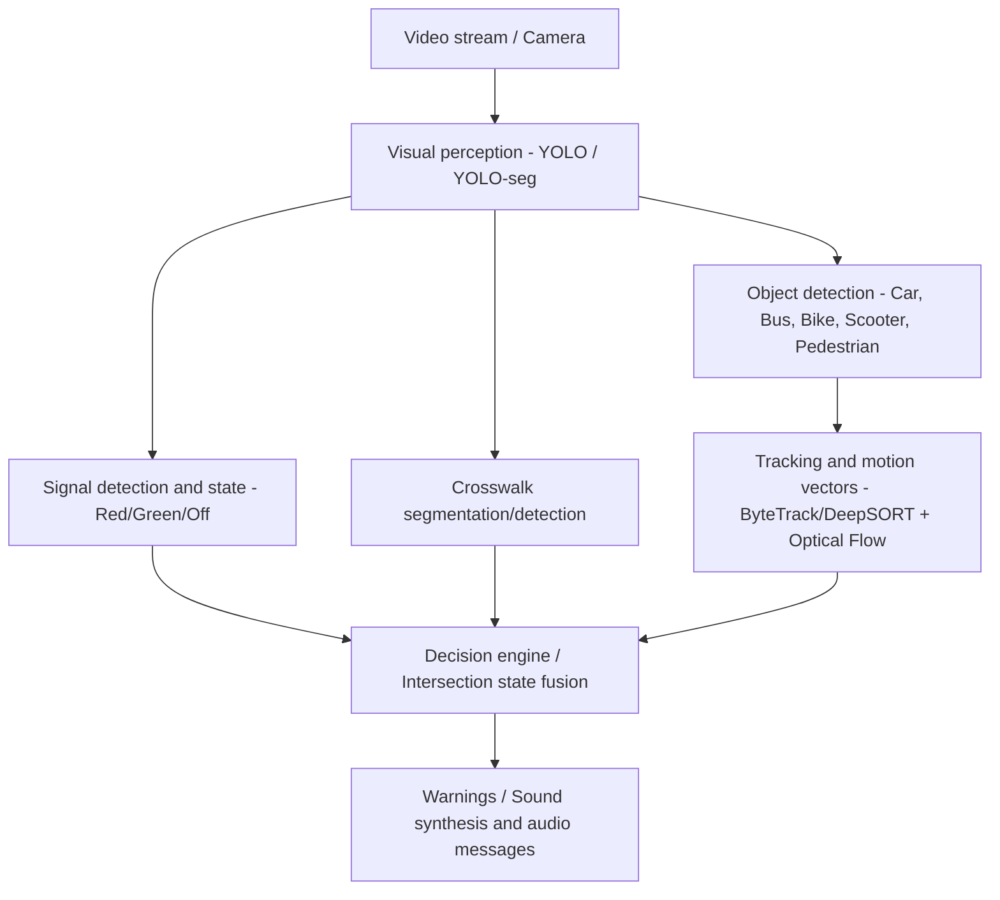
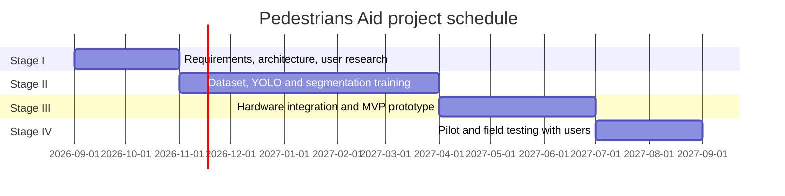

# Research and implementation project specification: Pedestrians Aid

## 1. Project details and main objective

- Project name: Pedestrians Aid, an early-warning and assistance system for pedestrians with visual impairments.
- Project type: research and implementation, covering edge AI, computer vision and assistive technology.
- Main objective: design, train and integrate a real-time audiovisual early-warning system
  combining hardware and software to compensate for limited perception among blind and
  partially sighted people in dynamic urban environments.

## 2. Motivation and research problem

1. New urban hazards: the growing share of quiet vehicles, including electric vehicles,
   hybrids, electric scooters and other personal mobility devices.
2. Limitations of traditional methods: white canes and guide dogs operate at close range.
   In street noise, hearing may not reliably detect vehicles with quiet electric drives.
3. Core safety requirement: prioritize reliability when assessing whether a road can be
   crossed safely. False green indications are critically unacceptable.

## 3. Functional scope and system architecture

### 3.1 Main functional modules

1. Traffic light detection and classification:
   - Detect pedestrian signals and general traffic signals.
   - Reliably classify `RED`, `GREEN`, `NO_SIGNAL` and `UNCERTAIN` states.
   - Use hysteresis or temporal smoothing to eliminate prediction flicker.
2. Crosswalk detection and segmentation:
   - Instance segmentation of zebra crossings to estimate the user's position relative
     to the crossing axis and distance to the road edge.
   - YOLOv8-seg, YOLO11-seg or a hybrid detection and mask-segmentation model.
3. Vehicle and obstacle tracking:
   - Detect cars, buses, bicycles, electric scooters, motorcycles and pedestrians.
   - Track multiple objects with methods such as BoT-SORT or ByteTrack.
   - Estimate time to collision, TTC, and motion toward the user's crossing area.
4. Safety and decision engine:
   - Fail-safe mode: uncertain predictions, low confidence or poor lighting trigger an
     uncertainty message rather than encouraging a risky action.
   - Prioritize events, for example an approaching vehicle over a green-light notification.
5. Audio and haptic feedback:
   - Short, intuitive spoken messages and sounds with different frequencies.
   - Spatial or binaural sound, or bone-conduction headphones, to preserve awareness of ambient sound.

## 4. Nonfunctional and technical requirements

| Category | Requirement | Target |
|---|---|---|
| Latency | Frame processing and warning generation | At most 50-100 ms, at least 15-20 FPS on the edge device |
| Power consumption | Battery runtime | At least 4-6 hours of continuous use with intelligent standby |
| Reliability and safety | False green indication | 0%, a critical target with double verification |
| Recall/TPR | Approaching vehicle and obstacle detection | At least 95% in daylight and 90% in poorer lighting |
| Modular architecture | Replace models across PyTorch, ONNX, TensorRT, OpenVINO and NCNN | Full integration with edge deployment formats |

These are requirements of the original broader specification, not measured results of the current prototype.

## 5. Project stages and milestones

- Stage I, months 1-2: requirements, architecture and understanding user needs.
  Milestone: formal specification and architecture.
- Stage II, months 3-7: dataset acquisition, annotation, visual-model and tracking training.
  Milestone: models validated in a simulated or virtual environment.
- Stage III, months 8-10: mobile MVP with camera, edge processor and audio,
  followed by team testing in the lab and city.
- Stage IV, months 11-12: target-user testing, acceptance surveys,
  certification and final optimization.

## 6. Immediate implementation plan for the MVP / PoC

1. Environment and repository structure:
   - Prepare `src/`, `data/`, `models/`, `tests/` and `configs/`.
   - Configure Python with `ultralytics` for YOLOv8/v11 segmentation and detection,
     `opencv-python`, `torch` and `albumentations`.
2. Processing pipeline:
   - Support zebra-crossing segmentation and red/green signal detection.
   - Provide a script for testing and visualization on individual images and videos.
   - Prepare export and dataset-preparation modules for training and fine-tuning.
