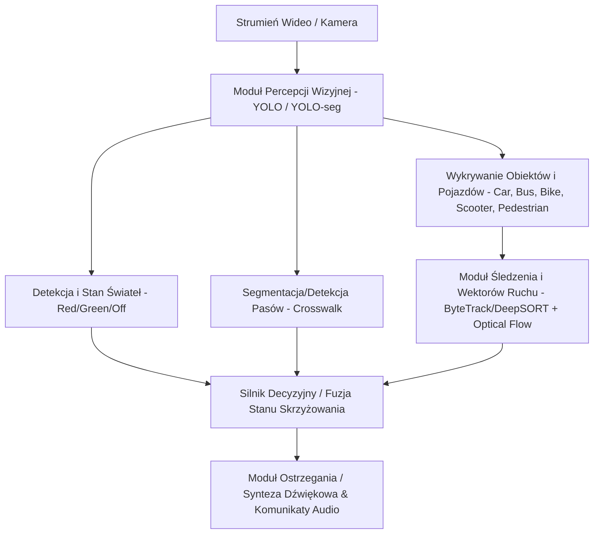
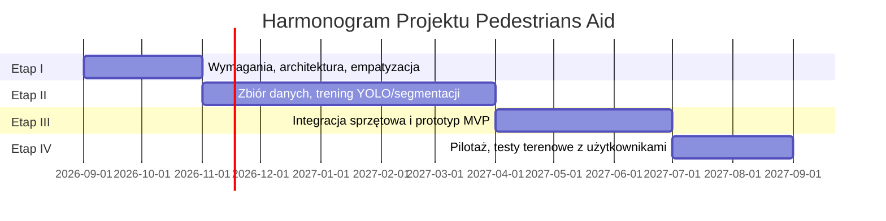

# Specyfikacja Projektu Badawczo-Wdrożeniowego: Pedestrians Aid

## 1. Metryka Projektu i Cel Główny
* **Nazwa projektu:** Pedestrians Aid (System Wczesnego Ostrzegania i Asysty Pieszych z Dysfunkcją Wzroku)
* **Charakter projektu:** Badawczo-wdrożeniowy (Edge AI / Computer Vision / Assistive Tech)
* **Cel główny:** Zaprojektowanie, wytrenowanie i zintegrowanie sprzętowo-programowego systemu wczesnego ostrzegania czasu rzeczywistego (audio-wizualnego), rekompensującego braki percepcyjne osób niewidomych i słabowidzących w dynamicznym środowisku miejskim.

---

## 2. Uzasadnienie i Problem Badawczy
1. **Nowe zagrożenia miejskie:** Dynamiczny wzrost udziału cichych pojazdów (Electric Vehicles, hybrydy, hulajnogi elektryczne / UTO – Urządzenia Transportu Osobistego).
2. **Ograniczenia tradycyjnych metod:** Biała laska i pies przewodnik działają w kontakcie bezpośrednim/bliskim; słuch w zgiełku ulicznym zawodzi przy pojazdach bezemisyjnych o cichym napędzie.
3. **Kluczowy wymóg bezpieczeństwa:** Bezwzględny priorytet niezawodności przy ocenie możliwości bezpiecznego przejścia przez jezdnię (False Positives w kontekście zielonego światła są krytycznie niedopuszczalne).

---

## 3. Zakres Funkcjonalny i Architektura Systemu

### 3.1 Główne Moduły Funkcjonalne

1. **Moduł Detekcji i Klasyfikacji Sygnalizacji Świetlnej (Traffic Light Engine):**
   * Wykrywanie sygnalizatorów dla pieszych oraz sygnalizatorów ogólnych.
   * Pewna klasyfikacja stanów: `CZERWONE`, `ZIELONE`, `BRAK_SYGNALIZACJI`, `STAN_NIEPEWNY`.
   * Mechanizm histerezy/wygładzania czasowego (temporal smoothing), aby wyeliminować migotanie predykcji.

2. **Moduł Detekcji / Segmentacji Przejścia dla Pieszych (Crosswalk Segmentation):**
   * Segmentacja instancyjna pasów (zebra crossing) w celu oceny pozycji użytkownika względem osi przejścia oraz odległości do krawędzi jezdni.
   * Model YOLOv8-seg / YOLO11-seg lub hybrydowy (detekcja + segmentacja masek).

3. **Moduł Detekcji i Estymacji Wektorów Ruchu (Vehicle & Obstacle Tracking):**
   * Detekcja pojazdów (samochody, autobusy, rowery, hulajnogi elektryczne, motocykle, piesi).
   * Śledzenie wieloobiektowe (Object Tracking np. BoT-SORT / ByteTrack).
   * Estymacja Time-To-Collision (TTC) oraz wektora zbliżania się do strefy przejścia użytkownika.

4. **Silnik Decyzyjny i Logika Bezpieczeństwa (Safety & Decision Engine):**
   * Failsafe Mode: w przypadku niepewności predykcji (niski confidence score, niesprzyjające oświetlenie), system informuje o braku pewności i nie zezwala na podjęcie ryzyka.
   * Priorytetyzacja zdarzeń (np. nadjeżdżający pojazd > informacja o zielonym świetle).

5. **Interfejs Użytkownika / Informacja Zwrotna (Audio / Haptic Feedback):**
   * Krótkie, intuicyjne komunikaty głosowe oraz sygnały dźwiękowe o zróżnicowanej częstotliwości (dźwięki przestrzenne / binauralne lub słuchawki z przewodnictwem kostnym, by nie zasłaniać dźwięków otoczenia).

---

## 4. Wymagania Niefunkcjonalne i Techniczne

| Kategoria | Wymaganie | Cel / Wartość |
| :--- | :--- | :--- |
| **Opóźnienie (Latency)** | Czas przetwarzania klatki i generowania ostrzeżenia | $\le 50 - 100 \text{ ms}$ (min. 15–20 FPS na urządzeniu brzegowym) |
| **Pobór Mocy** | Czas pracy na jednym ładowaniu | $\ge 4 - 6 \text{ h}$ ciągłej pracy (z inteligentnym trybem czuwania) |
| **Niezawodność (Safety)** | Błędne wskazanie zielonego światła (False Positive Green) | $0\%$ (kryterium krytyczne; mechanizm podwójnej weryfikacji) |
| **Skuteczność (Recall/TPR)** | Wykrywanie zbliżających się pojazdów i przeszkód | $\ge 95\%$ w warunkach dziennych, $\ge 90\%$ przy gorszym oświetleniu |
| **Architektura Modułowa** | Łatwość zamiany modeli (PyTorch -> ONNX -> TensorRT / OpenVINO / NCNN) | Pełna integracja z formatami brzegowymi |

---

## 5. Etapy Realizacji Projektu (Harmonogram i Kamienie Milowe)

* **Etap I (Miesiące 1–2):** Definiowanie wymagań, architektury oraz empatyzacja (Kamień milowy: sformalizowana specyfikacja i architektura).
* **Etap II (Miesiące 3–7):** Pozyskanie baz danych, adnotacja, trening modeli wizyjnych i śledzenia (Kamień milowy: zwalidowane modele w środowisku symulacyjnym/wirtualnym).
* **Etap III (Miesiące 8–10):** Budowa mobilnego prototypu MVP (kamera + procesor brzegowy + audio) i testy laboratoryjno-miejskie zespołu.
* **Etap IV (Miesiące 11–12):** Testy z grupą docelową, ankiety akceptacji, certyfikacja i optymalizacja końcowa.

---

## 6. Plan Działań Wdrożeniowych na Dziś (Faza MVP / PoC)

1. **Środowisko i struktura repozytorium:**
   * Przygotowanie struktury katalogów (`src/`, `data/`, `models/`, `tests/`, `configs/`).
   * Konfiguracja środowiska Python z bibliotekami `ultralytics` (YOLOv8/v11 Segmentation & Detection), `opencv-python`, `torch`, `albumentations`.
2. **Potok Przetwarzania (Pipeline):**
   * Obsługa segmentacji przejść dla pieszych (zebra crossing) oraz detekcji świateł (traffic light red/green).
   * Skrypt do testowania i wizualizacji na pojedynczych zdjęciach / filmach wideo.
   * Przygotowanie modułu eksportu i przygotowania danych treningowych / fine-tuningu.
